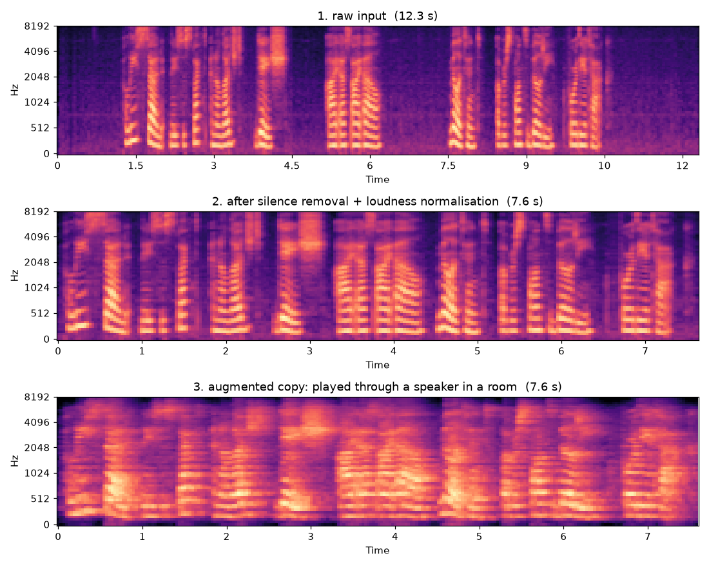

# Data report

| Class | Files | Skipped | Groups | Raw audio (min) | After cleaning (min) | Windows (incl. aug) |
|---|---|---|---|---|---|---|
| human | 9640 | 0 | 4885 | 1710.7 | 1476.3 | 57681 |
| ai | 8280 | 3 | 2780 | 1226.7 | 1081.4 | 47999 |

## Per language (files)

| Language | Human | AI |
|---|---|---|
| en | 3852 | 3567 |
| ru | 2857 | 2632 |
| team | 67 | 41 |
| uz | 2864 | 2037 |

## AI files per attack type

| Attack | Files |
|---|---|
| Neural TTS (Microsoft) | 2692 |
| Voice changer: pitch shift | 1034 |
| Voice cloning (XTTS-v2) | 873 |
| Voice changer: formant / gender | 853 |
| Vocoder resynthesis | 719 |
| Neural TTS (Piper / VITS) | 600 |
| Voice changer: speed+pitch | 553 |
| Neural TTS (Google) | 500 |
| Voice changer: robot | 359 |
| Classic TTS (Windows SAPI) | 60 |
| AI played through a real speaker | 18 |
| User-reported mistakes | 11 |
| Other AI | 5 |

Mean loudness before: -27.7 dBFS (std 10.6) -> after: -20.0 dBFS (std 0.2)
Silence removed: 379.7 min

