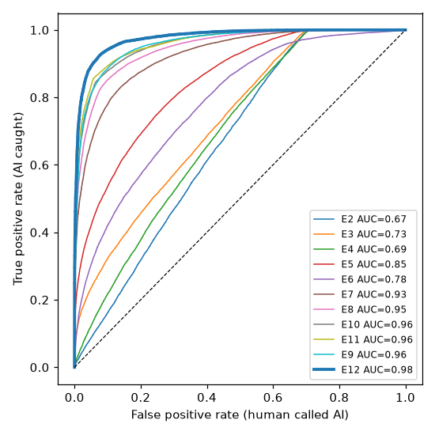

# Experiments

5-fold cross-validation grouped by speaker / TTS voice; metrics per recording (clean + degraded versions). EER = equal error rate (lower is better), the standard anti-spoofing metric.

| # | Approach | What changed | Accuracy | F1 (AI) | ROC-AUC | EER | **EER uz/en/ru** | EER (top-half windows) | Params | ms / 2 s window | Selected |
|---|---|---|---|---|---|---|---|---|---|---|---|
| E1 | Baseline (majority class) | - | 0.539 | 0.000 | 0.500 | 0.500 ± 0.000 | 0.500 | 0.500 | - | 0.01 |  |
| E2 | Logistic regression | 99 hand-crafted acoustic features | 0.623 | 0.699 | 0.668 | 0.395 ± 0.032 | 0.392 | 0.399 | - | 0.21 |  |
| E3 | Random forest (old demo) | same features, 300 trees | 0.623 | 0.709 | 0.731 | 0.357 ± 0.018 | 0.355 | 0.361 | - | 41.19 |  |
| E4 | SVM (RBF) | same features | 0.621 | 0.698 | 0.694 | 0.377 ± 0.018 | 0.376 | 0.379 | - | 0.47 |  |
| E5 | Random forest + augmentation | + replay/codec/noise augmented copies | 0.750 | 0.721 | 0.845 | 0.249 ± 0.008 | 0.248 | 0.255 | - | 41.75 |  |
| E6 | VoxCNN (own) - no augmentation | log-mel, 4 conv blocks | 0.684 | 0.716 | 0.785 | 0.302 ± 0.017 | 0.300 | 0.304 | 313k | 1.21 |  |
| E7 | VoxCNN (own) - small + augmentation | 4x fewer channels, + aug + SpecAugment | 0.847 | 0.828 | 0.925 | 0.156 ± 0.016 | 0.153 | 0.169 | 83k | 3.67 |  |
| E8 | VoxCNN (own) + augmentation | + replay/codec/noise aug + SpecAugment | 0.877 | 0.861 | 0.947 | 0.126 ± 0.011 | 0.122 | 0.137 | 313k | 1.82 |  |
| E10 | VoxCNN-wide (own) + augmentation | 2x channels (more capacity) | 0.894 | 0.880 | 0.959 | 0.112 ± 0.010 | 0.109 | 0.118 | 1215k | 1.02 |  |
| E11 | WavLM-Base+ (pretrained, frozen) + own MLP | self-supervised speech features (reused) + our classifier | 0.903 | 0.890 | 0.963 | 0.103 ± 0.014 | 0.099 | 0.109 | 94M frozen + 1196k | 25.0 |  |
| E9 | Ensemble E5 + E10 | average of best classical + best CNN | 0.891 | 0.876 | 0.960 | 0.107 ± 0.010 | 0.104 | 0.113 | - + 1215k | 42.77 |  |
| E12 | Ensemble E10 + E11 | average of our CNN + WavLM classifier | 0.921 | 0.911 | 0.977 | 0.077 ± 0.015 | 0.072 | 0.084 | 1215k + 94M frozen + 1196k | 26.02 | ✔ |

**Selected: E12 – Ensemble E10 + E11** — lowest EER on uz/en/ru = 0.072 (AUC 0.977).
Rule: lowest EER on the focus languages (uz/en/ru); models within 0.005 of the best count as equal and the fastest one wins. Focus languages are oversampled x1 in training.

Confusion matrix of the selected model (out-of-fold, rows = true, cols = predicted):

| | pred Human | pred AI |
|---|---|---|
| true Human | 28030 | 1190 |
| true AI | 3083 | 21956 |

## Selected model: detection per attack type

| Type | Recordings | Correct |
|---|---|---|
| Real human | 29220 | 95.9% |
| Neural TTS (Microsoft) | 8076 | 90.3% |
| User-reported mistakes | 77 | 32.5% |
| Neural TTS (Google) | 1500 | 80.7% |
| Other AI | 27 | 44.4% |
| Neural TTS (Piper / VITS) | 1800 | 82.3% |
| AI played through a real speaker | 126 | 27.8% |
| Classic TTS (Windows SAPI) | 180 | 76.1% |
| Voice changer: speed+pitch | 1675 | 71.8% |
| Voice changer: formant / gender | 2579 | 89.3% |
| Voice changer: pitch shift | 3118 | 95.8% |
| Voice changer: robot | 1089 | 98.9% |
| Vocoder resynthesis | 2173 | 92.2% |
| Voice cloning (XTTS-v2) | 2619 | 83.5% |

## Selected model: accuracy per language

| Language | Recordings | Human correct | AI caught |
|---|---|---|---|
| en | 22305 | 94.2% | 91.1% |
| ru | 16507 | 97.7% | 80.6% |
| team | 704 | 52.2% | 65.2% |
| uz | 14743 | 98.6% | 91.9% |
