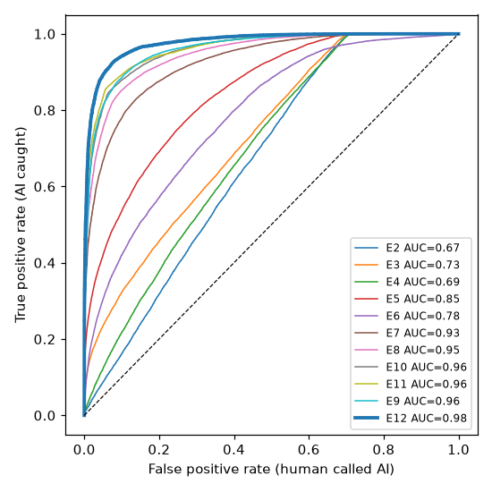

# Experiments

5-fold cross-validation grouped by speaker / TTS voice; metrics per recording (clean + degraded versions). EER = equal error rate (lower is better), the standard anti-spoofing metric.

| # | Approach | What changed | Accuracy | F1 (AI) | ROC-AUC | EER | **EER uz/en/ru** | EER (top-half windows) | Params | ms / 2 s window | Selected |
|---|---|---|---|---|---|---|---|---|---|---|---|
| E1 | Baseline (majority class) | - | 0.492 | 0.000 | 0.500 | 0.500 ± 0.000 | 0.500 | 0.500 | - | 0.01 |  |
| E2 | Logistic regression | 99 hand-crafted acoustic features | 0.731 | 0.785 | 0.770 | 0.314 ± 0.011 | 0.314 | 0.315 | - | 0.18 |  |
| E3 | Random forest (old demo) | same features, 300 trees | 0.733 | 0.792 | 0.825 | 0.288 ± 0.006 | 0.288 | 0.288 | - | 29.22 |  |
| E4 | SVM (RBF) | same features | 0.732 | 0.787 | 0.788 | 0.293 ± 0.014 | 0.294 | 0.296 | - | 0.45 |  |
| E5 | Random forest + augmentation | + replay/codec/noise augmented copies | 0.818 | 0.828 | 0.912 | 0.183 ± 0.002 | 0.186 | 0.185 | - | 28.66 |  |
| E6 | VoxCNN (own) - no augmentation | log-mel, 4 conv blocks | 0.790 | 0.814 | 0.889 | 0.214 ± 0.007 | 0.210 | 0.211 | 313k | 0.83 |  |
| E7 | VoxCNN (own) - small + augmentation | 4x fewer channels, + aug + SpecAugment | 0.894 | 0.893 | 0.961 | 0.107 ± 0.008 | 0.102 | 0.116 | 83k | 0.81 |  |
| E8 | VoxCNN (own) + augmentation | + replay/codec/noise aug + SpecAugment | 0.917 | 0.917 | 0.974 | 0.084 ± 0.006 | 0.078 | 0.092 | 313k | 0.8 |  |
| E10 | VoxCNN-wide (own) + augmentation | 2x channels (more capacity for 14 languages) | 0.929 | 0.929 | 0.980 | 0.074 ± 0.007 | 0.068 | 0.078 | 1215k | 1.83 |  |
| E11 | WavLM-Base+ (pretrained, frozen) + own MLP | self-supervised speech features (reused) + our classifier | 0.931 | 0.930 | 0.980 | 0.073 ± 0.007 | 0.066 | 0.079 | 94M frozen + 1196k | 25.0 |  |
| E9 | Ensemble E5 + E10 | average of best classical + best CNN | 0.928 | 0.928 | 0.979 | 0.073 ± 0.006 | 0.067 | 0.077 | - + 1215k | 30.49 |  |
| E12 | Ensemble E10 + E11 | average of our CNN + WavLM classifier | 0.948 | 0.948 | 0.988 | 0.051 ± 0.006 | 0.044 | 0.059 | 1215k + 94M frozen + 1196k | 26.83 | ✔ |

**Selected: E12 – Ensemble E10 + E11** — lowest EER on uz/en/ru = 0.044 (AUC 0.988).
Rule: lowest EER on the focus languages (uz/en/ru); models within 0.005 of the best count as equal and the fastest one wins. Focus languages are oversampled x2 in training.

Confusion matrix of the selected model (out-of-fold, rows = true, cols = predicted):

| | pred Human | pred AI |
|---|---|---|
| true Human | 25699 | 881 |
| true AI | 1928 | 25524 |

## Selected model: detection per attack type

| Type | Recordings | Correct |
|---|---|---|
| Real human | 26580 | 96.7% |
| Neural TTS (Microsoft) | 9028 | 96.6% |
| User-reported mistakes | 16 | 37.5% |
| Neural TTS (Google) | 1840 | 98.3% |
| Other AI | 4 | 50.0% |
| Neural TTS (Piper / VITS) | 2280 | 83.6% |
| AI played through a real speaker | 252 | 44.8% |
| Classic TTS (Windows SAPI) | 120 | 92.5% |
| Voice changer: speed+pitch | 1744 | 77.1% |
| Voice changer: formant / gender | 2778 | 93.8% |
| Voice changer: pitch shift | 3332 | 97.4% |
| Voice changer: robot | 1124 | 99.0% |
| Vocoder resynthesis | 2320 | 95.6% |
| Voice cloning (XTTS-v2) | 2614 | 89.3% |

## Selected model: accuracy per language

| Language | Recordings | Human correct | AI caught |
|---|---|---|---|
| ar | 1552 | 91.7% | 89.0% |
| az | 1566 | 96.2% | 89.7% |
| de | 1816 | 96.3% | 92.4% |
| en | 14862 | 95.9% | 94.3% |
| es | 1860 | 95.0% | 96.7% |
| fr | 1698 | 96.7% | 95.9% |
| hi | 1474 | 93.3% | 95.6% |
| kk | 1600 | 93.6% | 87.1% |
| ky | 1848 | 97.8% | 92.6% |
| ru | 10998 | 98.3% | 90.1% |
| team | 210 | 56.6% | 74.3% |
| tg | 1294 | 96.5% | 94.0% |
| tr | 1672 | 96.7% | 90.7% |
| uz | 9822 | 99.0% | 95.0% |
| zh | 1760 | 93.0% | 95.8% |
